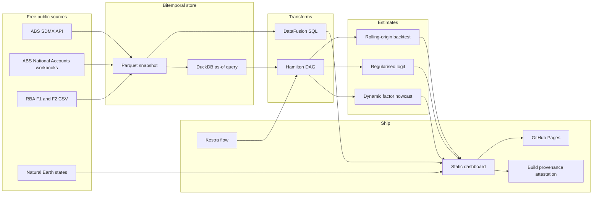

# Recession watch · Australia

[](https://github.com/LuciferDataEngineer/recession-watch-au/actions/workflows/ci.yml)
[](https://github.com/LuciferDataEngineer/recession-watch-au/actions/workflows/pages.yml)
[](LICENSE)

**Live dashboard:** https://luciferdataengineer.github.io/recession-watch-au/

How close is Australia to a recession, and where would it hit first? This project turns free ABS and RBA releases into a quarterly growth estimate, a chance that the next two quarters both shrink, and a state and industry scorecard. The September-quarter national accounts are due **2 December 2026, 11:30 am AEDT**. Until then the amber bars on the dashboard are an estimate, not an official print.

The page for decision-makers is the dashboard. The methods, the backtest, and the licences are here and in [INSIGHTS.md](INSIGHTS.md).

## The decision

Treasury, the Reserve Bank, state governments and businesses need a working answer to three questions before the official GDP print:

1. How likely is a technical recession (two quarters in a row of falling real GDP), and how does that differ from GDP per person?
2. Which states and industries are already under pressure?
3. Which early-warning indicators are actually moving?

As at the snapshot taken **22 November 2026, 9:23 am AEDT**:

| Question | Answer from this project |
| --- | --- |
| September quarter 2026 growth | **+0.2%** (about 0.0% to +0.5%) |
| December quarter 2026 growth | **+0.1%** (about −0.2% to +0.3%) |
| Chance both quarters shrink | **5%** |
| Chance the December quarter alone shrinks | **41%** |
| GDP per person, those two quarters | **−0.1%** then **−0.3%**; chance both are negative **67%** |
| Where the strain shows first | **New South Wales** on the combined score; **Victoria** has the highest unemployment (5.4%) and was the only state whose June-quarter demand fell (−0.3%) |

Official anchors, checked in CI against the snapshot: unemployment **4.9%** in October (highest since 2021), employment **−43,500**, youth unemployment **11.3%**, CPI **4.3%** in the year to September, cash rate **4.85%** from 4 November, June-quarter GDP **+0.4%** and GDP per person **0.0%**.

Westpac’s public nowcast of 20 November 2026 (their model, not this one) put September-quarter growth near 0.5%, the chance of a shrinking December quarter at 30%, and the chance of a technical recession at 5–6%. Our technical-recession chance is in the same neighbourhood. Our December-quarter chance is higher because our point estimate sits closer to zero.

## Architecture



Every observation is stored with a **valid time** (the quarter or month it describes) and a **transaction time** (when that vintage was published). A backtest at date T may use only rows with `publication_time <= T`. For GDP and GDP per person, the transaction time is the release date parsed from each ABS archive page, and the value is the number in that quarter’s own workbook. For the monthly series, the ABS API only serves the latest vintage, so the transaction time is the usual release lag (labour force month-end + 19 days, CPI on the last Wednesday of the next month, household spending + 35 days, building approvals + 40 days). That is a real-time ragged edge, not a full revision history. The distinction is spelled out in INSIGHTS.

## Tech stack

| Piece | Why it is here |
| --- | --- |
| **DuckDB 2.0.1** | Default warehouse. The as-of query is a window function over Parquet. Version pinned because 2.0.1 community extensions are incomplete; this project does not load any. HTTP downloads use `requests`, not the `httpfs` extension. |
| **Parquet snapshot + manifest** | CI never calls the network for data. `data/snapshot/manifest.json` records sha256, row counts, source URLs and the access time. |
| **Apache DataFusion (`datafusion` 55)** | Same silver query as DuckDB (lagged change in employment and state final demand), timed in `artifacts/engine_benchmark.json`. |
| **statsmodels `DynamicFactorMQ`** | Mixed-frequency dynamic factor model: monthly activity, quarterly GDP. This is the growth estimate. |
| **statsmodels `Logit.fit_regularized`** | Second recession check on the unemployment gap, bond spread, jobs, approvals and the cash rate. |
| **sf-hamilton 1.90** | The feature and model DAG. `artifacts/hamilton_lineage.png` is the rendered graph. The driver, not a side script, produces the dashboard payload. |
| **Kestra (`server local`, embedded H2)** | Orchestrator. Docker Compose locally; CI boots it and runs `kestra/flows/recession_watch.yml` end to end. Postgres is not used. |
| **Pandera** | Schema and anchor checks. A bad download that misses 4.9% unemployment fails CI. |
| **pytest, ruff, Playwright** | Unit tests, lint, and layout checks (KPI values on one line, map labels inside the map, charts sorted, no sideways scroll, desktop and mobile). |
| **GitHub Actions attestations** | `actions/attest-build-provenance` on the built dashboard and the snapshot manifest, then `gh attestation verify`. |
| **GitHub Pages** | Static HTML. No server, no paid host. |

## What’s new vs the previous project

Project 18, [china-trade-thaw](https://github.com/LuciferDataEngineer/china-trade-thaw), used DuckDB, DuckLake (Postgres catalog + RustFS), recursive SQL, CausalPy/PyMC, ODCS data contracts, Pandera, Arrow Flight, Testcontainers, Hypothesis and Playwright.

This project keeps Pandera, pytest, ruff, Docker and Playwright, and changes the parts that should change for a different question:

| Project 18 | This project | Why |
| --- | --- | --- |
| DuckLake catalog on Postgres + RustFS | Bitemporal valid-time / transaction-time tables in DuckDB + Parquet | The question is “what was published by date T?”. A window query answers it. DuckLake’s catalog would have required Postgres, which this brief allows only when it is genuinely needed. Kestra’s own database is embedded H2 via `server local`, so Postgres is not in the stack at all. |
| CausalPy / PyMC | `DynamicFactorMQ` mixed-frequency nowcast, plus a regularised logit and a rolling-origin vintage backtest | The target is a current-quarter GDP estimate with a ragged edge (jobs through October, prices and spending through September, GDP only through June). A factor model is built for that. PyMC was the previous project’s tool. |
| Single published extract | Real ABS National Accounts vintages, June 2019 through June 2026, release dates parsed from the archive pages | Backtests are scored on the first print of each quarter, not on today’s revised history. |
| Arrow Flight, Testcontainers, Hypothesis, ODCS | DataFusion beside DuckDB, Kestra as the orchestrator, GitHub artifact attestations | Flight and Testcontainers were the previous integration style. Kestra replaces Dagster/Airflow. Attestations are the supply-chain check, and they are free on GitHub Actions. Hypothesis property tests were not the highest-leverage check here; the anchor tests lock the published headlines instead. |

## Data sources

All of these are free. No API key. Access time for the committed snapshot: **2026-11-21T22:23:54Z** (22 November 2026, 9:23 am AEDT).

| Publisher | Series | URL | Licence | Coverage |
| --- | --- | --- | --- | --- |
| ABS | National accounts GDP and GDP per person | [latest release](https://www.abs.gov.au/statistics/economy/national-accounts/australian-national-accounts-national-income-expenditure-and-product/latest-release) and `ABS,ANA_AGG` | CC BY 4.0 | Seasonally adjusted chain-volume growth. Latest official quarter is June 2026, released 2 Sep 2026. Next release 2 Dec 2026, 11:30 am AEDT. |
| ABS | Key-aggregates workbooks, one per quarter | Archive pages such as [jun-2026](https://www.abs.gov.au/statistics/economy/national-accounts/australian-national-accounts-national-income-expenditure-and-product/jun-2026) | CC BY 4.0 | As-published GDP (`A2304370T`) and GDP per person (`A2304372W`) from the June 2019 release through the June 2026 release. |
| ABS | State final demand | `ABS,ANA_SFD` | CC BY 4.0 | Chain volume, seasonally adjusted, eight states and territories, through June 2026. |
| ABS | Labour force | [October 2026](https://www.abs.gov.au/statistics/labour/employment-and-unemployment/labour-force-australia/latest-release) | CC BY 4.0 | Employment, unemployment, participation. Released 19 Nov 2026, 11:30 am AEDT. NT and ACT use the smoothed series because this dataflow does not publish a seasonally adjusted series for them. |
| ABS | Youth unemployment | `ABS,LF_AGES` | CC BY 4.0 | Ages 15–24, seasonally adjusted. |
| ABS | Monthly CPI | [September 2026](https://www.abs.gov.au/statistics/economy/price-indexes-and-inflation/consumer-price-index-australia/latest-release) | CC BY 4.0 | All-groups index and annual change, weighted average of eight capital cities. The monthly figures used here are on dataflow `CPI` (the older `CPI_M` dataflow stops in 2025). |
| ABS | Household spending | [September 2026](https://www.abs.gov.au/statistics/economy/finance/monthly-household-spending-indicator/latest-release) | CC BY 4.0 | Current prices, seasonally adjusted. Released 4 Nov 2026. September was +0.6%. |
| ABS | Building approvals | [September 2026](https://www.abs.gov.au/statistics/industry/building-and-construction/building-approvals-australia/latest-release) | CC BY 4.0 | Original counts of new houses and other new dwellings. The release page is dated 9 Nov 2026. The seasonally adjusted total (17,948, +5.1%) is not in the SDMX slice used here; the model uses the original counts as a year-on-year change. |
| ABS | Business indicators | `ABS,QBIS` | CC BY 4.0 | Quarterly chain-volume sales growth by industry, through June 2026. |
| RBA | F1 daily cash-rate target, F1.1 monthly history | [f1-data.csv](https://www.rba.gov.au/statistics/tables/csv/f1-data.csv), [f1.1-data.csv](https://www.rba.gov.au/statistics/tables/csv/f1.1-data.csv) | RBA copyright. Statistical tables may be reproduced freely with attribution to the Reserve Bank of Australia. | Target is 4.85% from 4 November 2026. Daily table publication date in the file header is 20 Nov 2026. |
| RBA | F2 daily and F2.1 monthly government bond yields | [f2-data.csv](https://www.rba.gov.au/statistics/tables/csv/f2-data.csv), [f2.1-data.csv](https://www.rba.gov.au/statistics/tables/csv/f2.1-data.csv) | Same RBA terms. | 2-year and 10-year yields. Monthly history in the current file starts in 2013. Latest daily print in the snapshot is 18 Nov 2026: 2-year 4.813%, 10-year 5.080%, gap +0.27 points. |
| Natural Earth | Admin-1, 1:50m | [naturalearthdata.com](https://www.naturalearthdata.com/downloads/50m-cultural-vectors/) | Public domain | State boundaries for the map only. |

Retail trade on `ABS,RT` was not used. The seasonally adjusted total in that dataflow ends in June 2025, so it is not a current indicator. Household spending is the monthly spending series that is still being published.

## Cleaning and the model

1. SDMX CSV and RBA CSV are normalised to one row per series, period and vintage. Employment is scaled from thousands to people using `UNIT_MULT`. Percent series are left in percent.
2. Release instants are stored in UTC. Dashboard clocks render Australia/Melbourne.
3. The silver query (DuckDB and DataFusion) computes a lag change by series for employment and state final demand.
4. Monthly features from 2014: change in the unemployment rate, three-month percent change in employment, year-on-year change in new-dwelling approvals, three-month percent change in household spending, three-month change in the cash rate, and the 10-year minus 2-year yield. The sample starts in 2014 because fitting from 2000 made the EM step numerically unstable.
5. Quarterly GDP growth is the only low-frequency series inside the factor model. GDP per person is the GDP estimate minus the average gap between GDP growth and GDP-per-person growth over the last four published quarters (0.375 percentage points at this snapshot). That gap is population growth implied by the accounts, not a second model.
6. The factor model is `DynamicFactorMQ` with one factor, factor AR(1), and idiosyncratic AR(1). EM is capped (15 iterations for the published estimate, 8 in the backtest).
7. Recession chances treat the estimate as normal, with a scale equal to the root-mean-square miss **since 2023** (0.21 percentage points). The 2020 collapse was several percent in one quarter; folding it into the band would make every current estimate look directionless. The full-sample scores, including 2020, are still reported below.
8. The logit is a second opinion, trained only on quarters that had already been published at each origin.
9. State pressure is the average percentile rank of four components: three-month jobs change, three-month unemployment change, latest state-demand change, and year-on-year dwelling approvals. Higher means more pressure. It is a rank, not a probability.

## Backtest, in one table

Rolling origin from the September quarter 2019 through the June quarter 2026. At each origin (14 days before that quarter’s own release) the model sees only vintages already published, and it is scored on that quarter’s **first print**.

| Window | Factor model | Last-quarter-only (AR1) | Small regression on jobs and approvals | Historical average |
| --- | --- | --- | --- | --- |
| All 28 quarters, including 2020 | 2.33 | 1.84 | **1.38** | 1.83 |
| 14 quarters from 2023 | **0.21** | 0.55 | 0.51 | 0.51 |

Numbers are root-mean-square error, in percentage points of quarterly growth. Since 2023 the factor model is the best of the four. Across the whole window, including the lockdown collapse, the small regression wins and the factor model loses. That is reported rather than hidden: a one-factor model did not see a 7% fall coming. Brier scores for “will this quarter shrink?” are in INSIGHTS. There have been no negative quarters since 2021, so a model that almost never calls a negative quarter looks well calibrated on the recent window for a boring reason.

## Engine benchmark

Same SQL, 4,066 result rows, 8 repeats after a warm-up, on this snapshot:

| Engine | Seconds per run |
| --- | --- |
| DuckDB 2.0.1 | 0.018 |
| DataFusion 55 | 0.005 |

The results match. The table is small, so this is fixed overhead, not a claim about warehouse scale. Both engines are in-process and free. Re-run with `make run`; the numbers land in `artifacts/engine_benchmark.json`.

## Data model

`observations` and `gdp_vintages` share one schema:

| Column | Meaning |
| --- | --- |
| `series_id` | Stable name (`gdp_qoq`, `lf_unemp_AUS`, `yield_10y_daily`, …) |
| `period` | Valid time: `YYYY-MM`, `YYYY-Qn`, or a day for market rates |
| `period_start`, `period_end` | Calendar bounds of that period |
| `value` | Number in natural units (people, percent, index) |
| `vintage_id` | Which publication (`abs-ana-jun-2026`, `abs-api-latest`, …) |
| `publication_time` | Transaction time, UTC |
| `ingestion_time` | When this snapshot was pulled |
| `source`, `unit`, `title` | Provenance |

The as-of query keeps, for each series and period, the latest vintage with `publication_time <= T`. GDP is taken only from the workbook vintages, so the API’s revised history cannot leak into a backtest.

## How to run

```bash
python3 -m venv .venv && source .venv/bin/activate
pip install -r requirements.txt
python3 -m playwright install chromium   # layout tests only
sudo apt-get install -y graphviz         # lineage diagram only
make run                                 # rebuild site/ from the committed snapshot
make test                                # pytest, offline
make browser                             # Playwright
make lint
make snapshot                            # re-download ABS and RBA; needs the network
make kestra                              # docker compose, then the flow
# The local Kestra UI asks for a login. Use admin@kestra.io / Admin1234,
# the sample account from Kestra's own install guide. It only exists inside this container.
```

`PYTHONPATH=src` is set by the Makefile. The dashboard is `site/index.html`.

## Testing and CI

- `tests/test_vintage.py` checks that a later GDP revision is invisible before its release date.
- `tests/test_quality.py` checks the published anchors (4.9%, −43,500, 4.3%, 4.85%, +0.4%).
- `tests/test_engines.py` checks DuckDB and DataFusion agree.
- `tests/test_dashboard.py` rejects statistical jargon on the page and checks the four tabs.
- `tests/test_browser.py` checks desktop (1280) and mobile (390): no sideways scroll, KPI values on one line, map labels inside the map, bar charts sorted, exact-values tables open.
- GitHub Actions runs lint, tests, the rebuild, Playwright, a Kestra end-to-end flow, and attestation plus verification. Pages deploys `site/` from `main` only. This pull request does not deploy, and it is not merged from here.

## Dashboard

Four tabs, not one long page:

1. **Recession odds** — chance of two shrinking quarters, growth estimate, unemployment, cash rate.
2. **States** — pressure map, jobs, unemployment, June-quarter demand.
3. **Industries** — June sales volumes, household spending, home approvals.
4. **Early warnings** — unemployment gap, bond gap, youth unemployment, inflation, the 2 December release.

## Limitations and next steps

- Monthly series other than GDP do not have historical vintages. Revisions are invisible. Only the release lag is real-time.
- National Accounts workbooks before the June 2019 release are not in the snapshot; earlier pages do not expose the same workbook link.
- The factor model is a poor guide to a shock the size of 2020. Use the since-2023 error for ordinary quarters, and read the full-sample table before trusting it in a crisis.
- The logit has very few negative quarters to learn from. Its current “about 1%” is “this mix of indicators has rarely been followed by a shrinking quarter”, not a promise.
- GDP per person is the GDP estimate minus recent population growth implied by the accounts. It is not an independent nowcast.
- NT and ACT jobs are the smoothed series.
- Bond yields before 2013 are not in the current RBA monthly file.
- A paid nowcast vendor is not required and was not used.

## Licence

Code is MIT, see [LICENSE](LICENSE). Data stays under the publisher’s licence above. Attribute the Australian Bureau of Statistics and the Reserve Bank of Australia if you reuse the figures.
